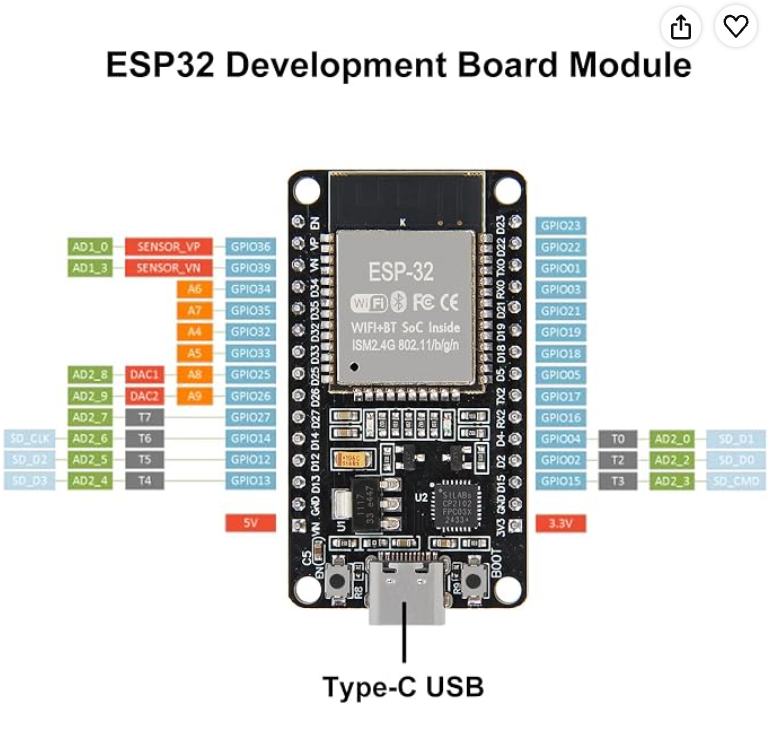

# Med-Alert

A two-stage medication reminder built on an ESP32 running FreeRTOS.

**Course:** CSE 321: Real Time and Embedded Operating Systems
**Checkpoint:** 1
**Team:** Jian Xi Lu, Isaac Loc

## Problem Statement

Missing medication doses is a serious problem for elderly people who live alone and for anyone who must take medicine on a strict schedule (for example antibiotics, heart medication, or diabetes medication). A missed dose can make the medicine less effective or lead to hospital visits. Family members need a way to know that patients are taking their treatments on time.

Phone alarms are not enough. They are easy to miss and leave no record of whether the medicine was actually taken.

Med-Alert fixes this with a dedicated device:

1. The board gets the current time from the internet.
2. At each scheduled medication time, it lights an LED and sounds a buzzer.
3. A 10-minute countdown starts on the board. If it reaches 0 without a button press, the board sends a notification to the caregiver's phone that the dose was missed.
4. If the patient takes the dose on time, they press the button. This stops the countdown and the alarm, and the board waits for the next scheduled time.

## Hardware

| Component | Purpose | Interaction |
| --- | --- | --- |
| ESP32 Dev Board (ESP-WROOM-32, 30-pin) | Microcontroller with built-in Wi-Fi | Reads the button. Drives the LED and buzzer through a transistor. Sends missed-dose notifications over Wi-Fi. |
| Buzzer | Audible reminder | Switched on and off by the ESP32 through the transistor. |
| LED | Visual reminder | Lit by the ESP32 while a dose is due. Turns off when the patient takes the medication. |
| Button | Patient interaction | Pressing it pulls the signal from HIGH to LOW, which turns off the LED and buzzer if they are on. |
| Resistor | Current limiting | Controls the current through the LED so it does not overheat. |

Final assembly is soldered onto perfboard. A breadboard is used during prototyping.

## Pinout

| Signal | GPIO | Connection |
| --- | --- | --- |
| LED | GPIO16 | Through a resistor to LED |
| Buzzer | GPIO17 | Drives the buzzer through the transistor |
| Button | GPIO4 | Button to GND, using the internal pull-up |

## Bill of Materials

| Item | Purpose | Price | Status |
| --- | --- | --- | --- |
| [ESP32 Dev Board](https://www.amazon.com/dp/B0DF2YJSHN) | Microcontroller with Wi-Fi | $8.99 | Order placed |
| [Electronics Fun Kit](https://www.amazon.com/dp/B01ERP6WL4) (buzzer, LED, button, transistor, resistors) | Alerts, dose confirmation, and protection components | $9.99 | Order placed |
| Perfboard / solderable breadboard | Soldered final assembly | n/a | Unconfirmed. Not essential to the build process now. Will be ordered later. |
| **Total** | | **$18.98** | |

## Software and Development Environment

- **[Visual Studio Code](https://code.visualstudio.com/):** main code editor.
- **[PlatformIO](https://platformio.org/):** VS Code extension used to build and flash the code.
- **[Arduino framework for ESP32](https://github.com/espressif/arduino-esp32):** provides the C++ API and includes FreeRTOS.
- **[GitHub repository](https://github.com/Isaac-Loc/Med-Alert):** shared repository for storing and managing the project code.

## RTOS Design

The project uses [FreeRTOS](https://www.freertos.org/), which ships with the Arduino ESP32 framework. No separate FreeRTOS installation is needed. PlatformIO downloads the framework, and FreeRTOS comes with it.

| Task | Priority | Function |
| --- | --- | --- |
| ConfirmTask | 3 (highest) | Button interrupt gives a semaphore that wakes the task. Turns off the LED and buzzer, stops the 10-minute timer, and logs the dose. |
| ReminderTask | 2 | Checks the clock each second. At the scheduled time, turns on the LED and buzzer and starts the 10-minute timer. |
| AlertTask | 1 | Waits on the missed-dose queue and sends the missed-dose notification to a device over Wi-Fi via [ntfy.sh](https://ntfy.sh/). |
| TimeSyncTask | 1 | Syncs the clock from an internet time source (NTP) every hour. |

The 10-minute timer is a FreeRTOS software timer. When it expires, its callback puts a message on the missed-dose queue for AlertTask.

**Why an RTOS:** the system has to keep time, sound the buzzer, run a 10-minute timer, watch the button, and send Wi-Fi notifications at the same time, and it must respond to the patient without delay. With an RTOS, each of these runs as a separate task with its own priority, so one task does not disturb another's timing. The button and alarm tasks have the highest priority, so pressing the button silences the buzzer immediately. FreeRTOS timers, queues, and mutexes pass missed-dose notifications between tasks and protect the dose log.

## Breadboard Wiring

Parts: ESP32 dev board, breadboard, jumper wires, LED, 220 Ω resistor (LED), about 1 kΩ resistor (transistor base), NPN transistor (such as a 2N2222), buzzer, push button.

1. Place the ESP32 in the middle of the breadboard. Connect its GND pin to the breadboard's negative rail.
2. **LED:** Connect GPIO16 to one leg of the 220 Ω resistor. Connect the other leg to the LED's long leg (anode). Connect the LED's short leg (cathode) to GND.
3. **Buzzer:** Connect the buzzer's positive leg to the ESP32's 5V pin. Connect its negative leg to the transistor's collector.
4. **Transistor:** Connect the emitter to GND. Connect GPIO17 to the base through the 1 kΩ resistor. Check the pin order against your transistor's datasheet.
5. **Button:** Connect one side to GPIO4 and the other side to GND. Do not connect it to 5V. The code uses the internal pull-up, so no extra resistor is needed.

Only the buzzer runs from the 5V pin. The LED and button are controlled by GPIO pins, which run at 3.3V, so do not send 5V into them.

## Build and Flash

1. Install [Visual Studio Code](https://code.visualstudio.com/) and the [PlatformIO](https://platformio.org/) extension.
2. Clone the repository and open the `Med-Alert` folder in VS Code.
3. Copy `include/secrets.example.h` to `include/secrets.h` and fill in your Wi-Fi name, Wi-Fi password, and ntfy topic URL. Do not commit this file.
4. Set the dose time and timeout in `include/config.h` if you want something other than 8:00 AM.
5. Build the project with the PlatformIO checkmark button, or run `pio run` in the terminal.
6. Connect the ESP32 with USB, then click the PlatformIO upload button, or run `pio run -t upload`.
7. Open the serial monitor at 115200 baud, or run `pio device monitor`, to see messages such as "Wi-Fi connected" and "Dose due."

## Project Status

- Problem statement, hardware design, and RTOS task design are complete (Checkpoint 1).
- ESP32 and electronics kit are ordered.
- Perfboard is not yet ordered.
